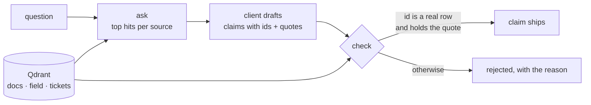

# org-knowledge-mcp

**Answer from your own sources through an MCP server that checks each claim against the line it cites.**

Picture a sales engineer asking Claude whether API keys can rotate with zero downtime. The answer
arrives confident and cited. Does the cited sentence exist, and does it say that?

This server gives an MCP client two tools. `ask` returns evidence from your product docs, field
notes and support history, each line with an id to cite. `check` takes the drafted answer back
before it ships and accepts a claim when its source exists and holds the quoted words.

Your client writes the answer. The server decides which evidence the client reads and which claims
count as sourced, in code, so the same claim gets the same verdict every time. A Qdrant cluster is all it
needs to run.

Built on [field-kit](https://github.com/meinsta/field-kit). Reads the collection that
[grounding-layer](https://github.com/meinsta/grounding-layer) keeps current.

## Install It in Your MCP Client

Build the collection first by running the grounding-layer refresh. Then:

```bash
pip install git+https://github.com/meinsta/org-knowledge-mcp
claude mcp add org-knowledge -e QDRANT_URL=... -e QDRANT_API_KEY=... -- org-knowledge-mcp
```

Ask your client: *"Can we rotate keys with zero downtime? Use org-knowledge."*

## Follow an Answer From Question to Checked Claim



This table lists each tool and its return value.

| Tool | Returns |
|---|---|
| `ask(question, source="")` | Evidence lines in the form `[id] (source · ref) text`. Leave `source` empty for the top 3 of every lane, so customer notes and tickets appear beside the docs. Name a lane for its top 6. |
| `check(claims)` | A verdict per claim. Each claim is `{"text", "source_id", "quote"}`, accepted when the id is a real row that holds the quote, and returned with the reason when it fails. |

A real exchange on the Quillfeather fixtures:

```
ask("Can we rotate keys with zero downtime?")
[94313d03…] (docs · docs/api-keys) Rotate a key from the console or with the rotate endpoint, and the old key keeps working for 24 hours.
[b909d2ba…] (field · call-001) Our security team will block the rollout unless we can rotate API keys without any downtime for the driver app.

check([{"text": "The old key works for 24 hours after rotation.", "source_id": "94313d03…", "quote": "the old key keeps working for 24 hours"},
       {"text": "Rotation is instant and free.",                  "source_id": "94313d03…", "quote": "rotation is instant and free of charge"}])
accepted: "The old key works for 24 hours after rotation."
rejected: "Rotation is instant and free." (quote is not in source)
```

## See the Results Measured on a Live Cluster

These numbers come from a Qdrant Cloud cluster over the Quillfeather collection: 23 points and 10
golden questions.

| Check | Result |
|---|---|
| `ask` returns the golden answer in its evidence | 10 of 10 questions |
| `check` accepts a sourced claim | 10 of 10 |
| `check` rejects a claim with a wrong quote or a wrong id | 20 of 20 |

Reproduce them with `python3 evaluate.py`.

## Add a Model When You Need to Judge Reasoning

`check` confirms that a claim's quote is in its source. Whether the claim follows from the quote
is a separate question: a client can quote a real sentence and conclude more than it says. Judging
that takes a model, and it belongs in its own verify step after `check`.

## Point It at Your Own Collection

Set `KNOWLEDGE_COLLECTION` to your collection. Each row needs `text`, `source` and `ref` in its
payload, and the collection needs a keyword index on `source`. Name your lanes in the `ask`
description in [`knowledge/server.py`](knowledge/server.py), because that description is what the
client reads when it chooses a lane.
