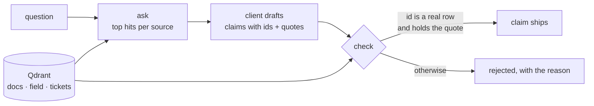

# org-knowledge-mcp

**An MCP server that answers from your own sources and proves every claim is cited.**

Install it in Claude, Cursor or any MCP client. `ask` returns evidence from your product docs, field
notes and support history, each line with an id to cite. `check` takes the answer back before it
ships: a claim passes when its source exists and holds the quoted words.

No model runs in the server. Your client writes the answer; code decides what it may read and
whether its claims are sourced. One cluster, no LLM key.

Built on [field-kit](https://github.com/meinsta/field-kit). Reads the collection that
[grounding-layer](https://github.com/meinsta/grounding-layer) keeps current.

## Get started

Build the collection first: run the grounding-layer refresh once. Then:

```bash
pip install git+https://github.com/meinsta/org-knowledge-mcp
claude mcp add org-knowledge -e QDRANT_URL=... -e QDRANT_API_KEY=... -- org-knowledge-mcp
```

Ask your client: *"Can we rotate keys with zero downtime? Use org-knowledge."*

## How an answer is built



| Tool | Returns |
|---|---|
| `ask(question, source="")` | Evidence lines: `[id] (source · ref) text`. With no `source`, the top 3 of every lane, so docs cannot crowd out what customers said. With one, the top 6 of that lane. |
| `check(claims)` | Each claim is `{"text", "source_id", "quote"}`. Accepted when the id is a real row and the row holds the quote. Rejected with the reason otherwise. |

A real exchange, from the Quillfeather fixtures:

```
ask("Can we rotate keys with zero downtime?")
[94313d03…] (docs · docs/api-keys) Rotate a key from the console or with the rotate endpoint, and the old key keeps working for 24 hours.
[b909d2ba…] (field · call-001) Our security team will block the rollout unless we can rotate API keys without any downtime for the driver app.

check([{"text": "The old key works for 24 hours after rotation.", "source_id": "94313d03…", "quote": "the old key keeps working for 24 hours"},
       {"text": "Rotation is instant and free.",                  "source_id": "94313d03…", "quote": "rotation is instant and free of charge"}])
accepted: "The old key works for 24 hours after rotation."
rejected: "Rotation is instant and free." (quote is not in source)
```

## What we found

Measured on a Qdrant Cloud cluster over the Quillfeather collection (23 points, 10 golden questions):

| Check | Result |
|---|---|
| `ask` puts the golden answer in the evidence | 10 of 10 |
| `check` accepts a sourced claim and rejects a wrong quote and a wrong id | 10 of 10 |

Reproduce it with `python3 evaluate.py`.

## What `check` does not do

It proves a claim's quote is in its source. It does not prove the claim follows from the quote: a
client can quote a real sentence and conclude something the sentence does not say. That judgment
needs a model, and it belongs in a separate verify step.

## Make it yours

Point `KNOWLEDGE_COLLECTION` at your own collection. Rows need `text`, `source` and `ref` in the
payload, and a keyword index on `source`. Name your lanes in the `ask` description in
[`knowledge/server.py`](knowledge/server.py), since that text is what the client reads to choose one.
